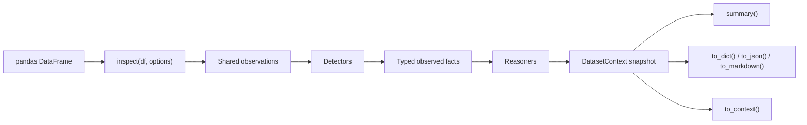

# Oribi v1 Architecture

## 1. Executive architectural decision

Build v1 as a small, pandas-first profiling library with a single public entry point, `inspect(df)`. It should compute a typed, immutable-enough snapshot in one pass through an explicit pipeline: input validation and shared observations, deterministic detectors, deterministic reasoning, then a reusable `DatasetContext`. Serializers only render that snapshot; they never inspect the original DataFrame or infer new semantics.

Use pandas and the Python standard library at runtime. Use dataclasses and enums (or constrained string literals) for the canonical model rather than adding Pydantic solely for internal representation. Keep the public model stable and serializable, while keeping detector protocols private in v1. The profile should retain facts separately from inferences and recommendations, and attach evidence to the latter. All heuristics should be deterministic, conservative, and allowed to return “unknown” or low confidence.

This narrows the README’s broad roadmap into a practical release: one in-memory pandas input; column profiling; semantic roles; candidate keys; a cautious grain estimate; basic relationships only where evidence is strong; recommendations and warnings; and human/AI-friendly output. Do not attempt to infer business definitions, prove keys, construct joins, or detect every temporal gap. The library provides evidence for analysis, not an answer to the analysis.

## 2. Architecture diagram



Detection owns what is observed. Reasoning owns qualified interpretations and recommendations. The context model owns the stable result. Renderers own presentation only.

## 3. Package structure

```text
oribi/
  __init__.py              # public API exports
  api.py                   # inspect(), profile options, and orchestration
  models/
    context.py             # dataset and column contexts
    evidence.py            # evidence, inferences, recommendations, and warnings
    profile.py             # profile and statistics models
  profiling/
    observations.py        # shared column observations
    columns.py             # missingness, cardinality, and value statistics
    temporal.py            # fixed cadence and potential temporal gaps
    relationships.py       # conservative within-frame relationship evidence
  reasoning/
    semantic.py            # semantic role inference
    keys.py                # candidate keys and grain selection
    rules.py               # warnings and aggregation recommendations
  serialization/
    dict.py                # canonical dictionary and JSON projection
    markdown.py            # human-readable Markdown rendering
    context.py             # compact context rendering
tests/
  test_api.py
  test_profiling.py
  test_semantics.py
  test_keys_grain.py
  test_reasoning.py
  test_relationships.py
  test_serialization.py
  test_audit_regressions.py
```

Avoid splitting every rule into a module or exposing the directory structure as public API. `oribi/profiling/relationships.py` is intentionally modest in v1: same-frame evidence such as duplicate/near-duplicate columns and plausible identifier-to-dimension links, without a join engine. Package metadata should declare supported Python versions and pandas version range in `pyproject.toml`; make pandas the sole required dependency. Test/lint tooling belongs in optional development dependencies.

## 4. Core models

All models are plain typed data objects. Collections should be tuples or copied mappings so a caller cannot accidentally mutate the stored snapshot through a shared list. Datetime, NumPy scalar, NaN, and pandas-specific values must be normalized at the serialization boundary.

```text
DatasetContext
├── profile: DatasetProfile
├── columns: tuple[ColumnContext, ...]
├── candidate_keys: tuple[KeyCandidate, ...]
├── grain: GrainContext | None
├── relationships: tuple[RelationshipContext, ...]
└── warnings: tuple[Warning, ...]

ColumnContext
├── name, dtype, logical_type
├── statistics: StatisticsContext
├── semantic: SemanticContext
├── recommendations: tuple[Recommendation, ...]
└── warnings: tuple[Warning, ...]
```

Suggested value objects:

- `DatasetProfile`: row_count, column_count, duplicate_row_count, duplicate_row_rate, index information only when useful and safely serializable.
- `StatisticsContext`: missing_count/rate, distinct_count/rate, numeric summary (min/max/mean/median/std/selected quantiles/zero/negative counts/skew), categorical top values, temporal bounds and optional frequency summary. Fields that do not apply are `None`, not fabricated zeroes.
- `SemanticContext`: `role` (identifier, measure, dimension, categorical, temporal, boolean, text, unknown), confidence in `[0, 1]`, and evidence items. Role is a best-fit label; logical type remains separately available.
- `Evidence`: stable code, concise statement, and structured details where useful (observed value, denominator, threshold). Evidence describes input facts; it is not a claim of business meaning.
- `KeyCandidate`: ordered column names, candidate kind (single/composite), confidence, uniqueness ratio, and evidence. “Candidate” never means guaranteed key.
- `GrainContext`: optional human-readable label, candidate columns, confidence, evidence, and status such as `estimated` or `undetermined`.
- `RelationshipContext`: source/target columns and relationship kind, observed overlap/coverage, confidence, and evidence. Only publish relations supported by stable value evidence.
- `Recommendation`: target/operation, disposition (`recommended`, `useful`, `valid`, `not_applicable`, `caution`), rationale and evidence.
- `Warning`: stable code, severity, title, message, evidence, analytical implication, and optional recommendation text.

Do not create a separate model for every statistic or a generic ontology framework. A concise `DatasetContext`, `ColumnContext`, and focused evidence-bearing value objects cover v1. The model should include a schema/version field in its serialized form from the first release so future readers can interpret changes.

## 5. Detection pipeline

`inspect` creates a per-call `AnalysisSession` (internal) containing the input frame, options, and memoized primitive observations. It does not retain the DataFrame in the returned context. Detectors consume the session and return typed facts; they do not call renderers or create warnings/recommendations.

1. **Input/schema detector** records shape, column labels, dtypes, index metadata where relevant, and duplicate row count. Validate unique, supported column labels; either support non-string labels by normalizing them to stable display labels while preserving original labels internally, or reject ambiguous labels with a clear error. The recommended v1 behavior is to support common scalar labels and reject duplicate labels.
2. **Shared column observations** compute null mask/count and distinct count once per column. Cache masks or reuse counts only within the inspection call to bound memory lifetime. Missingness follows pandas `isna()` semantics.
3. **Type detector** maps pandas dtypes and safe value checks to logical types: numeric, boolean, datetime, categorical, text, mixed/unknown. Object columns that appear datetime-like are not silently parsed by default: optional conservative parsing may be added behind an option after compatibility review.
4. **Numeric detector** computes min/max/mean/median/std and fixed quantiles; counts zeros and negatives; skew only when enough non-null observations exist and variance permits it. Quantile and skew calculations are the relatively expensive portion and should be controlled by `ProfileOptions` (default enabled for ordinary-sized frames, disabled or sampled over a documented threshold).
5. **Categorical/text detector** computes cardinality and a bounded top-k frequency table. It must avoid returning unbounded values or leaking huge/high-cardinality columns into summaries. Truncate long values in rendering, not in facts.
6. **Temporal detector** handles actual datetime dtypes, records min/max/range and simple inferred frequency only if reliable. Gap warnings are limited to a regular frequency that can be inferred with adequate confidence; no universal “missing dates” assertion.
7. **Key detector** records per-column uniqueness and tests a bounded set of composite candidates after single-column results. See section 7.
8. **Relationship detector** is conservative and optional in v1. It can report exact subset/coverage relationships for plausible key-to-dimension pairs with bounded work. It must not imply a valid join without key, null, and multiplicity evidence.

Each detector has a small internal protocol (`detect(session) -> facts`) and independent unit tests. The orchestrator schedules the known detector set in a fixed order, shares cached observations, and combines outputs. Avoid a plugin registry in v1; adding a protocol boundary gives future extension without making the initial implementation configurable for every user.

## 6. Reasoning pipeline

Reasoning consumes observations and produces explicit interpretations. It cannot revise facts. Each inference records `basis` evidence and confidence; each recommendation refers to the inference/facts that motivated it.

- **Semantic rules:** composable rules (name pattern, dtype/logical type, uniqueness, cardinality, null rate, value shape) emit scored role votes and evidence. A resolver combines votes with documented weights, applies tie/threshold policy, and returns `unknown` when scores are weak or close. For example, `*_id` plus mostly unique values supports identifier; numeric dtype alone does not make a measure. Keep name patterns as weak evidence and never make them decisive by themselves.
- **Warning rules:** evaluate typed conditions and produce structured warnings with stable codes. Severity reflects likely analytical impact, not certainty of business meaning. Examples: duplicate rows, high missingness, skew, negative values in a likely measure, high-cardinality dimension, and non-unique identifier-like columns.
- **Aggregation rules:** recommend sum/mean/median/min/max only for likely measures, with caution for negative values or high skew. For identifier-like columns recommend distinct count; disallow numeric aggregations on identifiers. Describe `COUNT` carefully because row count and entity count differ. These remain recommendations with evidence.
- **Key/grain rules:** rank candidate keys and grain hypotheses from key statistics and role evidence. A composite combination may have high uniqueness while still not represent a meaningful business grain, so expose columns and rationale rather than declaring certainty.
- **Relationships:** derive only from the relationship facts and key evidence. Leave ambiguous overlaps unreported rather than guessing foreign-key semantics.

Thresholds should be named constants or options, documented, deterministic, and tested at boundaries. Keep threshold tuning internal in the first release unless real users need configuration; avoid a large public configuration surface before the heuristics stabilize.

## 7. Grain detection

V1 should estimate the narrowest useful grain from likely entity identifiers and composite uniqueness, not attempt natural-language row description. Strategy:

1. Collect every qualifying single-column candidate using the existing identifier role, uniqueness, and missingness thresholds.
2. Independently evaluate pairs of non-unique identifier/dimension-like columns, even when one or more single-column candidates already exist. Canonicalize component names so input column order does not change candidate identity.
3. Bound pair search to the strongest `max_key_columns` components (default 8, at most 28 pairs) and skip exact pair scans above `max_exact_rows` (default 100,000). Retain every qualifying candidate within that bounded search.
4. Rank the collected candidates deterministically, listing simpler candidates first; ranking never discards a candidate. Grain selection is a separate step that prefers a qualifying single-column candidate, then chooses the strongest composite candidate when no single candidate exists.
5. Render an interpretable label such as `order_id × product_id` only as a hypothesis. Do not translate that into `order_item` unless an optional deterministic label rule is strongly supported; generic labels are safer.
6. Return `undetermined`/`None` with evidence when candidates are absent or ambiguous. Never force a grain.

Confidence is a calibrated heuristic score, not a probability. The context should say “likely grain” and list support and limitations. Composite search is O(k²) in selected columns and each exact combination scan is O(n); cap `k`, make computation policy explicit, and include a future path for sampling/sketches without changing the output model.

## 8. Public API

```python
import pandas as pd
from oribi import inspect

df = pd.read_csv("orders.csv")
context = inspect(df)

print(context.summary())
payload = context.to_dict()
json_text = context.to_json(indent=2)
markdown = context.to_markdown()
agent_context = context.to_context(max_chars=8_000)
```

Keep `inspect(df, *, options=None)` as the only required operation. `ProfileOptions` may expose a small stable set such as `top_k`, `include_quantiles`, `max_exact_rows`, and `sample_size`; defaults should be sensible and documented. The return object should be a `DatasetContext`. Add type hints and docstrings to all public members, and keep detector classes private. Importing `oribi` should not load optional AI integrations or perform work.

`summary()` returns a string, concise and deterministic. `to_dict()` returns JSON-compatible primitives. `to_json()` uses the standard library encoder and stable key ordering. `to_markdown()` is a human-readable full report. `to_context()` is a compact, bounded prompt-oriented summary; it uses already computed context and deterministic prioritization, never reruns analysis.

## 9. Context generation

`to_context()` should select from the canonical snapshot in this order: dataset size and duplicate rows; grain hypothesis and uncertainty; a short list of important columns (identifier, measure, temporal, then high-risk columns); relevant statistics; warnings; aggregation guidance; relationships; evidence. Omit low-value details and cap top values and output length. If a maximum length is requested, use deterministic truncation with an explicit “additional details omitted” marker, preserving warnings and grain evidence before secondary statistics.

Every statement should signal whether it is an observation (“observed”), inference (“likely”), or recommendation (“suggested”). For example, print exact unique counts as facts, role as a likely inference with evidence, and `COUNT(DISTINCT order_id)` as guidance. Avoid prompt instructions, code generation, or claims that the AI must follow the result. `to_markdown()` can include more fields than `to_context()`; both consume the same snapshot.

## 10. Testing architecture

Use behavior-focused pytest tests with small DataFrames constructed in fixtures. Organize tests by public behavior and output contract, not detector class layout. Representative fixtures: sales, order-items, customers, missing values, duplicate rows, skewed measure, negative transactions, dates, high-cardinality category, ambiguous grain, empty frame, single column, all-null column, and mixed object column.

Verify deterministic repeated output; role and evidence quality; numeric and temporal stats; key and grain uncertainty; recommendation and warning codes/evidence; JSON round-trip compatibility; Markdown/context presence and bounded output; and clear invalid-input errors. Test edge cases across supported pandas dtypes, nullable integer/boolean/string, timezone-aware datetimes, duplicate column labels, and empty/all-null data. Use tolerance assertions for floating-point statistics and exact assertions for counts/codes. Avoid tests that require one exact prose phrase when a structured code or model field is the contract.

Do not add brittle performance benchmarks to the default unit suite. Include a small optional benchmark script later when representative large frames and a performance budget are known. CI should cover the minimum and latest supported pandas versions and supported Python versions. A future snapshot test can cover serialized schema only after the format is treated as a compatibility contract.

## 11. Performance

The main costs are full-column scans for missingness/distinctness, quantiles, duplicate rows, and composite keys. In v1, favor exact results on ordinary frames and make expensive work bounded/configurable for large frames:

- Share per-column null/distinct/value observations; do not independently rescan for semantics, warnings, and recommendations.
- Compute DataFrame duplicate rows once.
- Make quantiles/skew optional beyond a documented row threshold; use a deterministic sample for approximate stats only if the output marks them as sampled and retains sample metadata.
- Limit top-k and composite key candidates; avoid pairwise checks across every column.
- Do not cache across calls or retain the source DataFrame in the result. Per-inspection memoization has an obvious lifetime and avoids stale results when users mutate frames.
- Add sampling/sketch implementations behind internal observation interfaces later, preserving the output model and marking approximate values.

Do not claim a strict memory/time bound for arbitrary pandas dtypes. Define documented guidance and ensure options can disable expensive profile sections. For very large frames, users can sample upstream or request a future chunked/source adapter; v1 is an in-memory DataFrame profiler.

## 12. v1 implementation phases

1. **Package foundation:** add `pyproject.toml`, supported Python/pandas ranges, package exports, version, license metadata, exceptions, and CI configuration.
2. **Domain model:** implement typed context/evidence/statistics models and JSON-compatible conversion contracts; add focused model tests.
3. **Core profiling:** input validation, schema, duplicate rows, missingness, cardinality, dtype/logical type, numeric/categorical/temporal summaries with shared observations.
4. **Semantic inference:** rule protocol, initial rules, scoring and uncertainty policy, evidence output; validate across fixture families.
5. **Keys and grain:** unique-column facts, bounded composite candidates, grain ranking and undetermined state.
6. **Reasoning:** warning rules, aggregation guidance, and conservative relationship facts/reasoning.
7. **Representations:** `summary`, dict, JSON, Markdown, and compact context renderers; schema/version handling and output bounds.
8. **Release quality:** docs/tutorial, API stability review, compatibility matrix, changelog, packaging smoke checks, and tagged v1 release criteria.

Each phase should leave a coherent tested increment. Keep documentation examples runnable against the implemented API before release. A v1 release should not be blocked on AI-provider plugins or external data sources.

## 13. Architectural risks

- **False semantic certainty:** column names and simple statistics can mislead. Mitigate with evidence, confidence, an unknown state, and cautious wording.
- **Grain overclaiming:** uniqueness does not establish business meaning. Report candidate columns and collision/missing evidence; do not force a label.
- **Cost surprises:** exact cardinality, quantiles, and combinations scan large data. Reuse scans, bound combinatorial work, provide options, and disclose sampling.
- **Unstable serialized format:** dictionaries can accidentally become an undocumented API. Version the schema and document which fields are stable before v1.
- **Too much output for agents:** full profiles waste context. Keep `to_context()` curated, concise, bounded, and evidence-first.
- **Pandas compatibility:** dtype behavior evolves, especially nullable and Arrow-backed dtypes. Centralize dtype mapping and test supported pandas versions.
- **Overgrown detector framework:** plugin systems, custom rule registration, and many configuration knobs create maintenance cost. Keep internals composable, but defer public extensibility until actual use cases establish the contract.
- **Relationships mistaken for joins:** matching values do not prove referential integrity or safe join cardinality. Expose observed overlap and uniqueness separately and explain implications.

## 14. Final recommended architecture

Implement a pandas-only, deterministic library with `inspect(df)` orchestrating a per-call analysis session. The session gathers shared typed observations once, feeds small composable detectors, then passes facts to independent reasoners. Reasoners create evidence-backed semantic inferences, warnings, recommendations, key candidates, cautious grain hypotheses, and limited relationship observations. A `DatasetContext` stores the complete snapshot without retaining the DataFrame.

Keep public API and dependencies small. Use typed dataclasses for the domain, standard-library JSON support, and separate pure renderers for summary, dictionary, JSON, Markdown, and compact AI context. Make expensive analysis bounded and configurable, with exactness/approximation visible in the model. Treat uncertainty as a valid result. This architecture directly supports the README’s goal while making v1 implementable, testable, and maintainable as a real open-source Python package.
